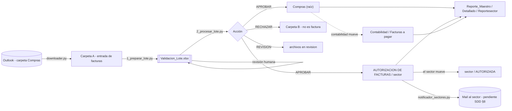

# SDD — Asistente Contable · Ciclo de Compras (v3)

> Software Design Document. Fuente de verdad del **diseño**. Las decisiones puntuales y su
> porqué están en [`docs/adr/`](adr/). Cómo operar el día a día está en [`RUNBOOK.md`](RUNBOOK.md).
> Al cambiar el comportamiento: actualizar este documento + un ADR nuevo + `CHANGELOG.md`.

| Campo | Valor |
|---|---|
| Versión | 3.0.0 (26/10/2026) |
| Dueño funcional | Administración y Finanzas (AyF) — Compras |
| Repositorio | `ing-gcastro/asistentecontable` |
| Plataforma | Windows 10/11 · Python 3.11+ (Anaconda) · Outlook de escritorio · recursos de red `\\10.10.10.210` |

---

## 1. Propósito y alcance

Automatizar la **recepción, validación, clasificación, archivo y seguimiento** de las facturas de
proveedores que llegan por mail a la casilla de Compras, hasta que quedan autorizadas por el sector
responsable y avanzan por las etapas contables (contabilizada → para pagar → pagada).

**Dentro del alcance (núcleo, `Proyecto_facturas_v2/`):** descarga de Outlook, validación (QR AFIP / CAE /
reglas), Excel de validación humana (Paso 1), archivo en red (Paso 2), reportes (maestro, sectores,
detallado), monitor de cambios y aviso a sectores.

**Satélites en el mismo repo (dominios separados, ver [ADR-0002](adr/0002-monorepo-por-dominios.md)):**

| Carpeta | Dominio | Relación con el núcleo |
|---|---|---|
| `compras_oc/` | Índice de Órdenes de Compra TELCOM | Importa `config` y `proveedores` del núcleo; escanea la misma carpeta de OC que usa `oc_manager.py` |
| `tesoreria_pagos/` | Legajos de pago y vinculación de avisos por mail | `indexar_legajos_pago.py` → `Reporte_Legajos_Pago.html` → lo parsean `vincular_*.py`. El núcleo solo lee las mismas carpetas (por nombre de archivo) para calcular la etapa |
| `datos_maestros/` | Limpieza puntual del maestro de proveedores | Ad-hoc, sin dependencias de código |
| `flota_seguros/` | División de pólizas por patente | Independiente |

**Fuera de alcance:** registración contable en el ERP, pagos, consultas online a AFIP/ARCA.

## 2. Actores

| Actor | Interacción |
|---|---|
| Analista de Compras | Corre MENU.bat: descarga, Paso 1, revisa el Excel, Paso 2 |
| Sector autorizante (RRHH, ADM, OPERACIONES, …) | Revisa los PDF en `AUTORIZACION DE FACTURAS\<sector>` y los mueve a `AUTORIZADA` |
| Contabilidad / Tesorería | Mueven el PDF por `Contabilidad` → `Facturas a pagar\Periodo Actual` → `Facturas a pagar\2026` |
| Proveedores | Envían facturas por mail |

## 3. Arquitectura

### 3.1 Módulos del núcleo

| Módulo | Responsabilidad | Efectos |
|---|---|---|
| `config.py` | Única fuente de rutas y constantes. Rutas locales calculadas por usuario; overrides en `config_local.py` | — |
| `pdf_rules.py` | Datos de reglas: frases de rechazo, regex, tipos AFIP | — |
| `qr_afip.py` | Decodifica el QR AFIP/ARCA (zxing-cpp → pyzbar → OpenCV) y lo normaliza | Lee PDF |
| `procesador_core.py` | Extracción y validación (`extraer_datos_pdf`, `es_factura_valida`, importes, ítems, CUIT) + modo interactivo legado | Lee PDF; el modo interactivo mueve archivos |
| `proveedores.py` | Maestro de proveedores y sectores (Excel) con caché | Lee Excel |
| `proveedor_rules.py` | Reglas por proveedor (remitentes confiables, Ecosan) | — |
| `oc_manager.py` | OCs disponibles / consumidas, PDF de la OC | `estado_oc.json` |
| `estado.py` | JSON de estado con escritura atómica, remitentes, registro, log de auditoría, espera de Excel abierto | Disco local |
| `downloader.py` / `auto_downloader.py` | Descarga de adjuntos desde Outlook (reglas Marino / Redguard-Aqualine) | Carpeta A, `emails_procesados.json`, `remitentes_descargas.json` |
| `1_preparar_lote.py` | PASO 1: analiza la Carpeta A y genera el Excel | `Validacion_Lote.xlsx`, `lote_datos.json` |
| `2_procesar_lote.py` | PASO 2: aplica el Excel, archiva, registra, reporta y notifica | Red, `registro_facturas.json` |
| `reporter.py` | Reporte maestro, por sector, consolidado y detallado | HTML/Excel en red, `cache_datos_pdf.json` |
| `monitor_compras.py` | Sondeo de `\Compras` + `AUTORIZACION` y regeneración de reportes | — |
| `notificador_sectores.py` | Mail por sector (preview / borrador / envío) | Outlook o `logs\notificaciones` |
| `verificar_entorno.py` | Chequeo de librerías y rutas | — |

Regla de dependencias: `config` ← `pdf_rules` ← `qr_afip` ← `procesador_core` ← (`1_`, `2_`, `reporter`).
`procesador_core` **no** importa Outlook ni el reporter al cargarse (imports tardíos), para que el Paso 1
y los tests funcionen en una PC sin Outlook.

## 4. Flujo detallado

### 4.1 Descarga (Outlook → Carpeta A)
1. Recorre la carpeta `Compras` de Outlook del más nuevo al más viejo hasta la fecha de inicio
   (tracking en `emails_procesados.json`; si no existe, 30 días).
2. Por cada mail con adjuntos PDF:
   - **Marino** (`facturacion@marinosa.com.ar`): fusiona todos los PDF en uno (la factura primero).
   - **Redguard / Aqualine**: fusiona todos los PDF + los Excel convertidos a PDF.
   - Resto: cada PDF por separado.
3. Guarda `{pdf: remitente}` en `remitentes_descargas.json` (lo usa el Paso 1 para los remitentes confiables).
4. Un mail que falla **no** se marca como procesado: se reintenta en la próxima corrida.

### 4.2 Clasificación (`es_factura_valida`)
Orden de decisión (ver [ADR-0005](adr/0005-reglas-de-rechazo.md) y [ADR-0004](adr/0004-qr-afip-local.md)):

| # | Regla | Resultado |
|---|---|---|
| 1 | QR AFIP con tipo factura/NC/ND (1,2,3,6,7,8,11,12,13,19-21,51-53,201-213) | ✅ válido |
| 1b | QR AFIP de recibo (4, 9, 15, 54) | ❌ rechazo |
| 2 | Frase de **rechazo explícito** en la 1ª página (`documento no valido como factura`, `recibo:`, `recibo de pago`, `keops`, …) | ❌ rechazo, aunque el remitente sea confiable |
| 3 | Remitente confiable | ✅ válido (solo relaja la exigencia de CAE) |
| 4 | Palabra prohibida (presupuesto, orden de compra, resumen de cuenta, …) **sin** CAE | ❌ rechazo |
| 5 | CAE detectado | ✅ válido |
| 6 | Dice "factura" y tiene número `PPPP-NNNNNNNN` | ✅ válido (fallback) |

El texto se normaliza (minúsculas, sin acentos) antes de comparar. El rechazo explícito se evalúa sobre la
**primera página** para que un recibo adjunto a una factura fusionada no tumbe la factura.

### 4.3 Extracción
Prioridad de fuentes: **QR AFIP > texto digital > OCR** (RapidOCR, luego Tesseract si está instalado).

| Dato | Fuente / regla |
|---|---|
| Tipo FC/NC/ND | QR `tipoCmp`, o regex sobre texto normalizado |
| Número | QR `nroCmp`, o `PPPP-NNNNNNNN`, `PPPPANNNNNNNN`, `Nro:` … |
| CUIT proveedor | QR `cuit`, o primer CUIT del texto que no sea del cliente (TELCOM/EUROSAT), priorizando dígito verificador válido |
| Fecha de emisión | QR `fecha`, o `Fecha:` / `Fecha de Emisión:` / `FECHA EMISION:` |
| Neto, IVA 21/10,5/27, otros impuestos, total | Regex con montos de 2 decimales (formato AR y anglosajón); total del QR si existe |
| Ítems | Heurística de línea "descripción cantidad precio subtotal" (depende del proveedor) |
| Razón social | Primera línea con forma societaria (SA, SRL, SAS, SCA) que no sea el cliente; luego etiqueta "Razón Social:" |

El nombre final del proveedor sale del **maestro de proveedores por CUIT**; la razón social del PDF es fallback.

### 4.4 Paso 1 — Excel de validación
Columnas editables: `Sector`, `OC_Detectada`, `Adjuntos_Extra`, `Tarjeta`, `Autorizar_Directo`,
`Nombre_Propuesto`, `Acción` (APROBAR / RECHAZAR / REVISION). Informativas: `Fecha_Emision`, `Total`,
`CUIT`, `Neto`, `IVA_*`, `Otros_Impuestos`, `Items_Detectados`, `QR_AFIP`, `Motivo`.

Nombre propuesto: `[(VISA CORPO)] [(EUROSAT)] (MES) PROVEEDOR TIPO NUMERO SECTOR [-OC n]`, con **MES de la
fecha de emisión** (BUG-01; fallback: mes actual).

Duplicados: contra el historial (`Reporte_Maestro.html`, por razón social + número) y dentro del lote
(por CUIT o razón social + número) → `Acción = RECHAZAR` con marca `[DUPLICADA …]`.

### 4.5 Paso 2 — Aplicación
- APROBAR: fusiona OC y adjuntos extra si corresponde, ajusta prefijos (VISA CORPO / EUROSAT) y el sector en
  el nombre si se editó, copia a `\Compras` y mueve a `AUTORIZACION DE FACTURAS\<sector>` (o `\AUTORIZADA`
  si `Autorizar_Directo = SI`). Si el archivo no se puede archivar, queda en la Carpeta A para reintentar.
- Registra los datos de cada factura en `registro_facturas.json` (fecha de emisión, importes, ítems).
- Actualiza `Reporte_Maestro.html` (rápido, sin escanear la red), `Reporte_Maestro.xlsx`, los reportes por
  sector y el detallado. La etapa contable se recalcula en la regeneración completa.
- Llama al notificador con lo aprobado en estado PENDIENTE.

### 4.6 Reportes

| Reporte | Ubicación | Fuente |
|---|---|---|
| `Reporte_Maestro.html` / `.xlsx` | `\Compras` | Histórico (el propio HTML) + PDF sueltos de `\Compras` (sin subcarpetas, MEJ-04) + aprobadas del Paso 2. Etapa por "gemelos" en `CARPETAS_ETAPAS`; estado por ubicación física en `AUTORIZACION` |
| `<sector>\Reporte.html`, `Reportesector.html` | `AUTORIZACION DE FACTURAS` | Escaneo físico de cada sector |
| `Reporte_Detallado.html` | `\Compras` | `registro_facturas.json` + `cache_datos_pdf.json`: desglose de impuestos, ítems y gráfico de evolución de precios por proveedor (Chart.js) |

Columnas del maestro: `Fecha Emisión`, `Fecha Carga`, `Empresa`, `Razón Social`, `Tipo`, `Nro Comprobante`,
`Subtotal`, `Total`, `OC`, `Información Adicional`, `Sector`, `Estado`, `Etapa Contable`, `Archivo`, `Ruta Completa`.

La **fecha de emisión** de facturas viejas se completa leyendo el PDF una sola vez (caché) con un tope de
`REPORTE_MAX_LECTURAS_PDF` por corrida (BUG-04, [ADR-0006](adr/0006-registro-local-de-facturas.md)).

### 4.7 Monitor (MEJ-05)
`monitor_compras.py` compara cada `MONITOR_INTERVALO_SEG` la "foto" (nombre, tamaño, fecha) de los PDF de
`\Compras` (raíz) y `AUTORIZACION` (recursivo). Ante cambios, espera `MONITOR_ESPERA_SEG` sin cambios y
regenera todos los reportes ([ADR-0008](adr/0008-monitor-por-sondeo.md)).

## 5. Datos y estado

| Archivo | Dónde | Quién escribe | Versionado |
|---|---|---|---|
| `emails_procesados.json` | `Proyecto_facturas_v2/` | downloader | No (estado local) |
| `remitentes_descargas.json` | idem | downloader → Paso 1 | No |
| `lote_datos.json` | idem | Paso 1 → Paso 2 | No |
| `registro_facturas.json` | idem | Paso 2 | No — **respaldar** (alimenta el reporte detallado) |
| `cache_datos_pdf.json` | idem | reporter | No (regenerable) |
| `estado_oc.json` | idem | oc_manager | No — **respaldar** |
| `logs/*.log`, `logs/notificaciones/` | raíz | todos | No |
| Maestros Excel | `%USERPROFILE%\ROBOTS\data\` | humanos | No |

Todos los JSON se escriben de forma **atómica** (archivo temporal + reemplazo), así que un corte no los corrompe.

## 6. Requisitos no funcionales

| Atributo | Decisión |
|---|---|
| Portabilidad | Sin rutas de usuario hardcodeadas; Python detectado por `scripts/_python.bat` ([ADR-0011](adr/0011-lanzador-unico-de-python.md)) |
| Costo | 100% local y gratuito: sin IA ni APIs pagas; QR y OCR locales |
| Robustez en red | Rutas UNC; sondeo en lugar de eventos del SO; tope de lecturas por corrida |
| Seguridad / privacidad | Estado con mails y asuntos fuera de git; HTML con escape; mails desactivados por defecto |
| Auditoría | `logs\paso1_preparar_lote_AAAA-MM.log` y `paso2_…` con usuario y fecha de cada corrida |
| Calidad | Tests `unittest` (sin red ni Outlook) + CI en GitHub Actions (Windows) |
| No destructivo | No se cierra Excel a la fuerza ([ADR-0012](adr/0012-no-cerrar-excel-a-la-fuerza.md)); los archivos solo se mueven entre carpetas conocidas |

## 7. Pruebas
`VERIFICAR.bat` (o `python -m unittest discover -s Proyecto_facturas_v2/tests`). Cubren: montos, mes por
fecha de emisión, recibos (BUG-02), PDF fusionado factura+recibo, QR real dentro de un PDF, importes e ítems,
dígito verificador del CUIT, lectura del reporte viejo sin corromper números, detección de duplicados,
flujo completo Paso 1 → Paso 2 → reportes → notificación, y monitor solo con PDF sueltos.

## 8. Notificación por mail a sectores — **PENDIENTE DE DEFINICIÓN**

**Estado:** lógica implementada y conectada al Paso 2 y a `ejecutar_recordatorio_sectores.bat`, **desactivada**
(`NOTIFICACION_MODO = "desactivado"`): solo genera vistas previas en `logs\notificaciones\`. Ver
[ADR-0009](adr/0009-notificacion-a-sectores.md).

Contenido actual del mail: tabla con fecha de emisión, proveedor, comprobante, OC, total y link al PDF, total
general e instrucción "mover a AUTORIZADA para autorizar".

**Decisiones abiertas (a completar antes de activar):**

| # | Pregunta | Opciones | Default propuesto |
|---|---|---|---|
| N1 | Destinatarios por sector | casillas individuales / listas de distribución | Una lista por sector en `NOTIFICACION_DESTINATARIOS` |
| N2 | Cuándo avisar | al aprobar (Paso 2) / resumen diario / ambos | Ambos: aviso inmediato + recordatorio diario 9:00 (tarea programada) |
| N3 | Modo de salida | borrador para revisar / envío directo | `borrador` el primer mes, después `enviar` |
| N4 | ¿Adjuntar PDF? | adjuntos / solo link a la red | Solo link (`NOTIFICACION_ADJUNTAR_PDF = False`) |
| N5 | Escalamiento | recordar pendientes con más de N días | N = 5 días hábiles, con copia a AyF |
| N6 | Cuenta de envío | buzón personal / buzón compartido de Compras | Buzón compartido |

**Activación:** completar `NOTIFICACION_DESTINATARIOS`, poner `NOTIFICACION_MODO = "borrador"`, correr el
recordatorio y revisar los borradores; luego `"enviar"`. Registrar la decisión en un ADR nuevo.

## 9. Evolución prevista (backlog técnico)

| Prioridad | Ítem | Notas |
|---|---|---|
| P1 | Activar notificaciones (§8) | Solo configuración |
| P1 | Tarea programada del monitor o de `ejecutar_reportes.bat` cada 10 min | Ver RUNBOOK |
| P2 | Validar CUIT del QR contra el maestro y alertar diferencias | Detecta facturas apócrifas |
| P2 | Reglas de ítems por proveedor (plantillas) para mejorar la evolución de precios | `pdf_rules.py` |
| P2 | Reporte de antigüedad de pendientes por sector | Reutiliza `pendientes_por_sector()` |
| P3 | Separar satélites en repos propios si crecen (`git subtree split -P tesoreria_pagos`) | ADR-0002 |
| P3 | Base SQLite en lugar de JSON si el registro supera ~50 000 facturas | ADR-0006 |
| P3 | Verificación online del CAE en AFIP (WSCDC) | Requiere certificado AFIP |

## 10. Glosario
**CAE**: Código de Autorización Electrónico de AFIP. **QR AFIP**: código QR obligatorio en comprobantes
electrónicos, con los datos del comprobante en Base64. **Carpeta A/B**: entrada / descartes. **Gemelo**: el
mismo comprobante (razón social + número) encontrado en otra carpeta, que define su etapa contable.
