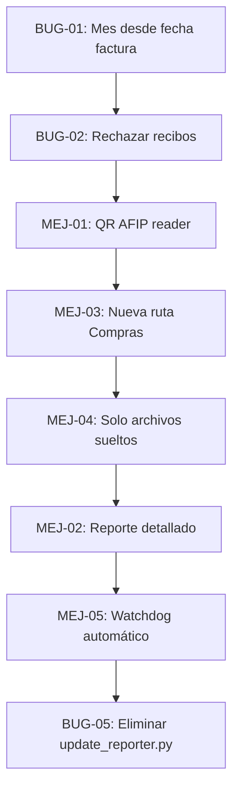

# 📋 QA Report — Asistente Contable · Proyecto Facturas v2

> **Preparado para colaboración QA Engineering**
> Fecha: 26/10/2026 | Repositorio: `ing-gcastro/asistentecontable`

---

## 🗂️ Índice

1. [Errores activos identificados](#errores-activos)
2. [Mejoras solicitadas](#mejoras-solicitadas)
3. [Evaluación técnica por ítem](#evaluacion-tecnica)
4. [Mapa de archivos afectados](#mapa-archivos)

---

## 1. Errores activos identificados {#errores-activos}

### 🔴 BUG-01 — Mes del nombre de archivo tomado desde la fecha del sistema, no de la factura

| Campo | Detalle |
|---|---|
| **Severidad** | Alta |
| **Archivos afectados** | [`1_preparar_lote.py` L84-87](file:///c:/Users/gcastro/ROBOTS/asistentecontable/Proyecto_facturas_v2/1_preparar_lote.py#L84-L87), [`procesador_core.py` L340-341](file:///c:/Users/gcastro/ROBOTS/asistentecontable/Proyecto_facturas_v2/procesador_core.py#L340-L341) |
| **Impacto** | Facturas de meses anteriores quedan archivadas con el mes corriente |

**Descripción del bug:**

En **Paso 1** (`1_preparar_lote.py`), el mes para el `Nombre_Propuesto` se calcula únicamente con la fecha actual del sistema:

```python
# L84-87 de 1_preparar_lote.py — BUG: siempre usa datetime.now()
mes_actual = int(datetime.now().month)
meses = {1:"ENERO", 2:"FEBRERO", ...}
nombre_mes = meses.get(mes_actual, "MES")
```

El campo `fecha_emision` **sí se extrae correctamente** en `procesador_core.py` (L223-225) y se retorna en el diccionario `datos`, pero **no se usa en `1_preparar_lote.py`** para calcular el mes del nombre. Sólo `procesador_core.py` L418-425 (modo interactivo) hace la conversión correcta.

**Corrección esperada:**  
En `1_preparar_lote.py`, después de obtener `datos`, usar `datos.get("fecha_emision")` para derivar el mes, con fallback al mes actual si la fecha no se pudo extraer:

```python
# Corrección propuesta
from config import MESES_ESPANOL
fecha_emision = datos.get("fecha_emision", "")
if fecha_emision:
    try:
        dt_em = datetime.strptime(fecha_emision, "%d/%m/%Y")
        nombre_mes = MESES_ESPANOL.get(dt_em.month, nombre_mes)
    except Exception:
        pass
```

---

### 🔴 BUG-02 — Recibos de pago clasificados como facturas válidas

| Campo | Detalle |
|---|---|
| **Severidad** | Alta |
| **Archivos afectados** | [`procesador_core.py` L54-102](file:///c:/Users/gcastro/ROBOTS/asistentecontable/Proyecto_facturas_v2/procesador_core.py#L54-L102), [`pdf_rules.py`](file:///c:/Users/gcastro/ROBOTS/asistentecontable/Proyecto_facturas_v2/pdf_rules.py) |
| **Ejemplo real** | Recibo 0002-00032472 de Volquetes y Transportes Marino S.A. |

**Descripción del bug:**

El documento adjunto por el usuario es un **Recibo de pago** (no factura) emitido por el sistema *Keops 360*. Contiene el texto "**DOCUMENTO NO VALIDO COMO FACTURA**" y "**Recibo: 0002-00032472**". Sin embargo pasa el filtro de `es_factura_valida()` porque:

1. `es_factura_por_remitente()` retorna `True` para `"facturacion@marinosa.com.ar"` → **la función ignora el contenido del PDF si el remitente está en lista blanca** (proveedor_rules.py L11-16).
2. Si no viene por correo, el texto "**Recibo**" y "**DOCUMENTO NO VALIDO COMO FACTURA**" **no están incluidos** en la lista `documentos_no_factura` de `procesador_core.py` L61-67.
3. El PDF contiene números de 14 dígitos en el campo "Importe" que podrían disparar el patrón de CAE (`re.search(r"\b[678]\d{13}\b")`).

**Lista actual de palabras prohibidas en `pdf_rules.py`** — ausentes:
- `"recibo"` / `"recibo de cobro"` / `"duplicado de recibo"` (solo hay "duplicado de recibo")
- `"documento no valido como factura"`
- `"keops"`

**Corrección esperada:**
1. Agregar a `documentos_no_factura` en `procesador_core.py`: `"recibo:"`, `"documento no valido como factura"`, `"duplicado de recibo"`.
2. Agregar a `palabras_prohibidas` en `pdf_rules.py` los mismos valores.
3. Hacer que `es_factura_por_remitente()` **no bypass completo**: si el texto contiene "documento no valido como factura", rechazar incluso si el remitente es conocido. El remitente de confianza debería sólo relajar la exigencia del CAE, no ignorar los rechazos explícitos.

---

### 🟡 BUG-03 — `reporter.py` usa `fc a subir` como fuente de datos, pero se va a cambiar el destino

| Campo | Detalle |
|---|---|
| **Severidad** | Media (bloqueante para MEJ-04) |
| **Archivos afectados** | [`reporter.py` L9-10, L195-216](file:///c:/Users/gcastro/ROBOTS/asistentecontable/Proyecto_facturas_v2/reporter.py#L195-L216) |

La constante `CARPETA_C` actualmente apunta a `\\10.10.10.210\...\Compras\fc a subir`. El reporte escanea esa carpeta buscando PDFs "sueltos" para armar el histórico. Al mover los archivos directamente a `\Compras` (sin subcarpeta), hay que ajustar tanto la ruta de destino como la lógica de escaneo. Ver MEJ-04.

---

### 🟡 BUG-04 — Fecha del reporte muestra `st_mtime` (fecha de modificación del archivo), no la fecha de la factura

| Campo | Detalle |
|---|---|
| **Severidad** | Media |
| **Archivos afectados** | [`reporter.py` L200-203](file:///c:/Users/gcastro/ROBOTS/asistentecontable/Proyecto_facturas_v2/reporter.py#L200-L203) |

Cuando se scanean los archivos en `fc a subir`, la columna **Fecha** se llena con `st_mtime` (última modificación del archivo en disco), no con la fecha de emisión de la factura. Esto es distinto de BUG-01 (el nombre del archivo) pero tiene el mismo origen: la fecha de la factura no se persiste en el nombre del archivo ni se lee del PDF en el reporter.

---

### 🟡 BUG-05 — `update_reporter.py` edita `reporter.py` en runtime con slices frágiles

| Campo | Detalle |
|---|---|
| **Severidad** | Media (deuda técnica) |
| **Archivos afectados** | [`update_reporter.py`](file:///c:/Users/gcastro/ROBOTS/asistentecontable/Proyecto_facturas_v2/update_reporter.py) |

`update_reporter.py` abre `reporter.py`, hace slice de líneas (`lines[:165]`, `lines[292:]`) y escribe un nuevo bloque de código hardcodeado. Esto romperá silenciosamente si `reporter.py` crece o se modifica. Es un anti-patrón: la lógica debería vivir directamente en `reporter.py`.

---

## 2. Mejoras solicitadas {#mejoras-solicitadas}

### ✨ MEJ-01 — Análisis de QR de facturas para validación e identificación

**Descripción:** Las facturas AFIP incluyen un código QR que contiene datos estructurados (CUIT, tipo, punto de venta, número, fecha, importe, CAE). Leer el QR permitiría:
- Validar que el documento **es efectivamente una factura** (no un recibo).
- Extraer con exactitud: CUIT del emisor, número de comprobante, fecha de emisión, importe total.
- Eliminar la dependencia de regex frágiles para esos datos.

**Evaluación técnica — Restricción: Plan gratuito de IA:**

El QR de AFIP no requiere IA para decodificarse: es un código QR estándar que contiene una URL del tipo:
```
https://www.afip.gob.ar/fe/qr/?p=BASE64_DE_JSON
```

El JSON decodificado contiene todos los datos. **Esto es 100% gratuito** y no usa IA:
- Librería Python: `opencv-python` + `pyzbar` o `qreader` para decodificar el QR desde el PDF.
- PyMuPDF ya está disponible para renderizar páginas a imagen.
- La decodificación del JSON devuelto por AFIP es local.

**Flujo propuesto:**
1. Renderizar página 1 del PDF como imagen (ya se hace para OCR).
2. Detectar y decodificar QR con `pyzbar` (sin IA).
3. Parsear la URL, decodificar el parámetro `p` de Base64 → JSON.
4. Extraer: `cuit`, `tipoCmp`, `nroCmp`, `fechaEmision`, `importeTotal`.
5. Si el QR se decodifica → el documento es un comprobante AFIP → validar adicionalmente contra lista de tipos aceptados (1=FC-A, 6=FC-B, 11=FC-C, 3=NC-A, etc.).

**Nueva dependencia:** `pyzbar` (gratuita, MIT) + `Pillow` (ya presente en reqs).

> [!TIP]
> El QR de AFIP es la fuente de datos más confiable posible. Si el PDF tiene QR → extraer todo del QR y confiar en esos datos. Si no hay QR → usar el pipeline regex actual como fallback.

> [!NOTE]
> Un recibo como el del ejemplo (Keops 360) **no tiene QR AFIP**, por lo que automáticamente caería en el pipeline de regex donde debería ser rechazado por BUG-02 (una vez corregido).

---

### ✨ MEJ-02 — Reporte detallado con desglose de impuestos y subtotales (sin eliminar Reporte_Maestro)

**Descripción:** Generar un nuevo reporte `Reporte_Detallado.html` que coexista con `Reporte_Maestro.html`. El reporte detallado debe incluir:

| Columna nueva | Fuente |
|---|---|
| `Subtotal (Neto)` | `rx_subtotal` ya extraído en `procesador_core.py` |
| `IVA 21%` | Nuevo regex a agregar en `pdf_rules.py` |
| `IVA 10.5%` | Nuevo regex |
| `Otros impuestos` | Nuevo regex (Percepciones, IIBB, etc.) |
| `Total` | Nuevo regex ya en muchas facturas |
| `Precio Unitario` | Nuevo regex — línea de detalle de factura |
| `Descripción` | Nuevo regex — concepto/descripción de item |
| `Unidades` | Nuevo regex |

**Funcionalidad clave: evolución de precios por proveedor**
El reporte detallado debería incluir una **vista/gráfico de evolución de precio** por razón social, usando Chart.js (gratuito, CDN). Al hacer clic en un proveedor → filtrar y ver gráfico de precio a lo largo del tiempo.

**Arquitectura propuesta:**
- Nueva función `generar_reporte_detallado()` en `reporter.py`.
- Nueva constante en `config.py`: `REPORTE_DETALLADO_HTML`.
- Nuevos campos en `pdf_rules.py`: `rx_iva_21`, `rx_iva_105`, `rx_total`, `rx_percepciones`.
- Los nuevos campos se capturan en `procesador_core.py → extraer_datos_pdf()` y se propagan al Excel de validación en `1_preparar_lote.py`.

---

### ✨ MEJ-03 — Cambio de destino: facturas aprobadas van directo a `\Compras` (no a `\Compras\fc a subir`)

**Descripción:** En el Paso 2 (`2_procesar_lote.py`), las facturas autorizadas actualmente se copian a:
- `\\10.10.10.210\...\Compras\fc a subir`  ← **ELIMINAR este destino**
- `\\10.10.10.210\...\AUTORIZACION DE FACTURAS\<sector>`  ← mantener

Nuevo destino único: `\\10.10.10.210\...\Compras` (raíz de carpeta, no subcarpeta).

**Archivos a modificar:**
- `config.py` → cambiar `CARPETA_C` de `Compras\fc a subir` a `Compras`.
- `2_procesar_lote.py` → ya usa `CARPETA_C`, el cambio en config propaga solo.
- `reporter.py` → `CARPETA_C` ya se usa para escanear PDFs, pero hay que agregar lógica de "solo archivos sueltos" (ver MEJ-04).

> [!IMPORTANT]
> Cambiar `CARPETA_C` en `config.py` afecta **todos los módulos que la importan**. Verificar impacto en: `reporter.py`, `procesador_core.py`, `2_procesar_lote.py`, `1_preparar_lote.py`.

---

### ✨ MEJ-04 — Reporte escanea solo archivos "sueltos" en `\Compras` (sin subcarpetas)

**Descripción:** Al mover el destino a la raíz de `\Compras`, el reporte no debe incluir archivos de subcarpetas (ej. `fc a subir`, `Contabilidad\...`, etc.). 

**Cambio requerido en `reporter.py`:**

```python
# ACTUAL: usa ruta_fc.glob("*.pdf") — ya es correcto para un nivel
for archivo in ruta_fc.glob("*.pdf"):  # ← sin rglob, solo nivel raíz ✅
```

La función `generar_reporte_html()` en L197 ya usa `ruta_fc.glob("*.pdf")` (sin recursivo), por lo que esto está **parcialmente correcto**. La issue real es que `CARPETA_C` apunta a `fc a subir`, no a `Compras`. Al cambiar `CARPETA_C` → `Compras`, el `glob("*.pdf")` de un solo nivel ya dará los archivos sueltos correctamente.

Sin embargo hay que verificar que la búsqueda de "gemelos" en `CARPETAS_CONFIG` (L251-255) **excluya explícitamente subcarpetas** de `\Compras` para no asignar etapa incorrecta a archivos ya procesados.

---

### ✨ MEJ-05 — Actualización automática del reporte cuando llegan archivos nuevos a `\Compras`

**Descripción:** El usuario indica que a los pocos minutos de subir el archivo a `\Compras`, alguien puede moverlo. El reporte debe detectar cambios en tiempo real o casi real.

**Opciones técnicas:**

| Opción | Descripción | Costo/Complejidad |
|---|---|---|
| **A) Watchdog con `watchdog`** | Usa eventos del SO (ReadDirectoryChangesW en Windows) para detectar nuevos/movidos archivos en `\Compras`. Al detectar cambio → regenera reporte. | Baja — librería `watchdog` gratuita |
| **B) Tarea programada Windows** | `ejecutar_reportes.bat` programado cada 5-10 min en el Programador de Tareas de Windows. | Muy baja complejidad |
| **C) Auto-refresh HTML** | Meta-refresh en el HTML cada N segundos. El script de actualización corre como daemon. | Media |

**Recomendación:** Opción A (watchdog) como daemon, lanzado desde un nuevo `ejecutar_monitor_compras.bat`. El monitor escucha eventos `FileCreatedEvent` y `FileMovedEvent` en la carpeta `\Compras` (nivel raíz) y llama a `generar_reporte_html()` + `generar_reporte_detallado()`.

**Pseudocódigo:**
```python
from watchdog.observers.polling import PollingObserver  # PollingObserver para rutas UNC de red
from watchdog.events import FileSystemEventHandler

class ComprasHandler(FileSystemEventHandler):
    def on_created(self, event):
        if not event.is_directory and event.src_path.lower().endswith('.pdf'):
            generar_reporte_html()
            generar_reporte_detallado()
    
    def on_moved(self, event):  # cuando alguien mueve el archivo
        generar_reporte_html()

observer = PollingObserver()  # PollingObserver: compatible con UNC/SMB
observer.schedule(ComprasHandler(), path=CARPETA_COMPRAS_RAIZ, recursive=False)
observer.start()
```

> [!IMPORTANT]
> Para rutas de red UNC (`\\servidor\...`), usar `PollingObserver` en lugar de `Observer` (el Observer nativo no funciona con SMB/CIFS en Windows).

---

## 3. Evaluación técnica por ítem {#evaluacion-tecnica}

| ID | Descripción | Complejidad estimada | Archivos principales |
|---|---|---|---|
| BUG-01 | Mes desde fecha factura | 🟢 Baja (2-3 líneas) | `1_preparar_lote.py` |
| BUG-02 | Rechazar recibos | 🟡 Media (regex + lógica) | `procesador_core.py`, `pdf_rules.py`, `proveedor_rules.py` |
| BUG-03 | Reporter con nueva ruta | 🟢 Baja (config) | `config.py`, `reporter.py` |
| BUG-04 | Fecha factura en reporte | 🟡 Media | `reporter.py`, requiere persistir fecha |
| BUG-05 | Eliminar update_reporter.py | 🟢 Baja (refactor) | `update_reporter.py`, `reporter.py` |
| MEJ-01 | QR AFIP sin IA | 🟡 Media | `procesador_core.py`, nueva `qr_reader.py` |
| MEJ-02 | Reporte detallado + gráficos | 🔴 Alta | `reporter.py`, `pdf_rules.py`, `procesador_core.py`, `config.py` |
| MEJ-03 | Nueva ruta destino Compras | 🟢 Baja | `config.py` |
| MEJ-04 | Solo archivos sueltos | 🟢 Baja | `reporter.py` |
| MEJ-05 | Watchdog automático | 🟡 Media | Nueva `monitor_compras.py`, nuevo `.bat` |

---

## 4. Mapa de archivos afectados {#mapa-archivos}

```
Proyecto_facturas_v2/
├── config.py              ← MEJ-03 (CARPETA_C), MEJ-02 (constante reporte detallado)
├── pdf_rules.py           ← BUG-02 (palabras prohibidas), MEJ-01 (tipos QR), MEJ-02 (rx IVA/total)
├── procesador_core.py     ← BUG-01 (mes), BUG-02 (lógica validación), MEJ-01 (QR reader)
├── proveedor_rules.py     ← BUG-02 (bypass remitente)
├── 1_preparar_lote.py     ← BUG-01 (mes), MEJ-02 (nuevos campos en Excel)
├── 2_procesar_lote.py     ← MEJ-03 (ruta), MEJ-04 (escaneo)
├── reporter.py            ← BUG-03/04, MEJ-02, MEJ-04, BUG-05
├── update_reporter.py     ← BUG-05 (eliminar o refactorizar)
└── [nuevo] monitor_compras.py  ← MEJ-05
```

---

## 5. Orden de implementación sugerido



> **Prioridad 1 (Bugs críticos):** BUG-01, BUG-02
> **Prioridad 2 (Cambio de flujo operativo):** MEJ-03, MEJ-04
> **Prioridad 3 (Nuevas funcionalidades):** MEJ-01, MEJ-02, MEJ-05
> **Prioridad 4 (Deuda técnica):** BUG-05
